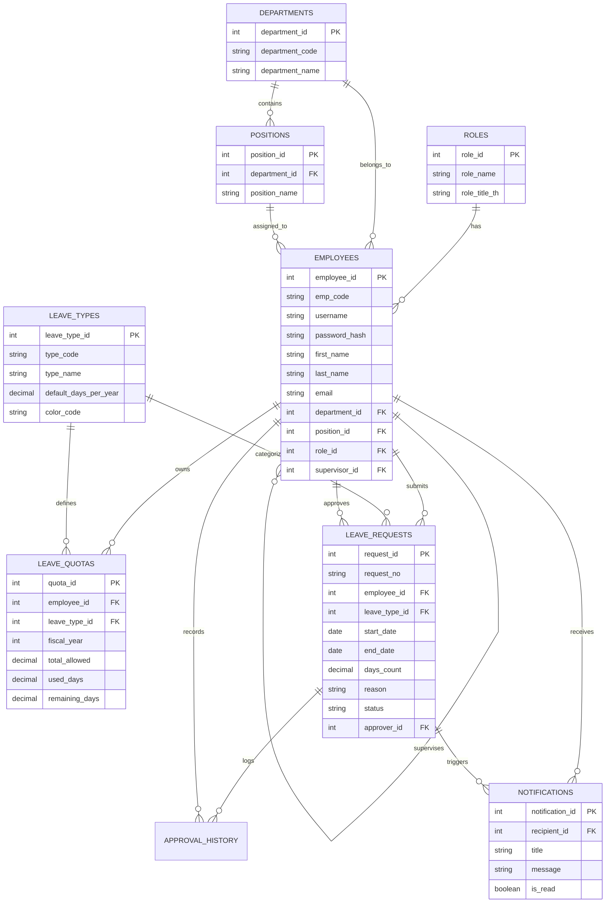

# พจนานุกรมข้อมูลและแบบจำลองฐานข้อมูล (Data Dictionary & ER Diagram)
## โครงการ: ระบบการลา (Leave Management System)
**วิชา / เอกสาร:** การวิเคราะห์และออกแบบระบบ (System Analysis and Design - SA)

---

## 1. แบบจำลองความสัมพันธ์ของข้อมูล (Entity-Relationship Diagram: ERD)

---

## 2. พจนานุกรมข้อมูล (Data Dictionary)

### 2.1 ตาราง: `roles` (บทบาทผู้ใช้งาน)
| ชื่อฟิลด์ (Field) | ชนิดข้อมูล (Data Type) | Nullable | คีย์ (Key) | คำอธิบาย (Description) |
| :--- | :--- | :---: | :---: | :--- |
| `role_id` | INT | NO | **PK** | รหัสบทบาท (Auto Increment) |
| `role_name` | VARCHAR(50) | NO | **UNIQUE** | รหัสภาษาอังกฤษ เช่น EMPLOYEE, SUPERVISOR, HR |
| `role_title_th` | VARCHAR(100) | NO | - | ชื่อแสดงผลภาษาไทย (พนักงาน, หัวหน้างาน, เจ้าหน้าที่ HR) |
| `description` | VARCHAR(255) | YES | - | คำอธิบายหน้าที่ความรับผิดชอบ |

---

### 2.2 ตาราง: `departments` (แผนก / ฝ่าย)
| ชื่อฟิลด์ (Field) | ชนิดข้อมูล (Data Type) | Nullable | คีย์ (Key) | คำอธิบาย (Description) |
| :--- | :--- | :---: | :---: | :--- |
| `department_id` | INT | NO | **PK** | รหัสแผนก (Auto Increment) |
| `department_code` | VARCHAR(20) | NO | **UNIQUE** | รหัสย่อแผนก เช่น DEPT-01 |
| `department_name` | VARCHAR(100) | NO | - | ชื่อเต็มของแผนก |

---

### 2.3 ตาราง: `positions` (ตำแหน่งงาน)
| ชื่อฟิลด์ (Field) | ชนิดข้อมูล (Data Type) | Nullable | คีย์ (Key) | คำอธิบาย (Description) |
| :--- | :--- | :---: | :---: | :--- |
| `position_id` | INT | NO | **PK** | รหัสตำแหน่งงาน |
| `department_id` | INT | NO | **FK** | อ้างอิงแผนก (`departments.department_id`) |
| `position_name` | VARCHAR(100) | NO | - | ชื่อตำแหน่งงาน |

---

### 2.4 ตาราง: `employees` (พนักงานและบัญชีผู้ใช้)
| ชื่อฟิลด์ (Field) | ชนิดข้อมูล (Data Type) | Nullable | คีย์ (Key) | คำอธิบาย (Description) |
| :--- | :--- | :---: | :---: | :--- |
| `employee_id` | INT | NO | **PK** | รหัสไอดีพนักงาน |
| `emp_code` | VARCHAR(20) | NO | **UNIQUE** | รหัสประจำตัวพนักงาน เช่น EMP-0042 |
| `username` | VARCHAR(50) | NO | **UNIQUE** | ชื่อผู้ใช้สำหรับล็อกอินเข้าระบบ |
| `password_hash` | VARCHAR(255) | NO | - | รหัสผ่านเข้ารหัสปลอดภัย (Bcrypt/Argon2) |
| `prefix` | VARCHAR(20) | YES | - | คำนำหน้าชื่อ (นาย, นาง, นางสาว) |
| `first_name` | VARCHAR(100) | NO | - | ชื่อจริงพนักงาน |
| `last_name` | VARCHAR(100) | NO | - | นามสกุล |
| `email` | VARCHAR(100) | NO | **UNIQUE** | อีเมลพนักงาน |
| `phone` | VARCHAR(20) | YES | - | เบอร์โทรศัพท์ติดต่อ |
| `department_id` | INT | NO | **FK** | แผนกที่สังกัด (`departments.department_id`) |
| `position_id` | INT | NO | **FK** | ตำแหน่งงาน (`positions.position_id`) |
| `role_id` | INT | NO | **FK** | บทบาทในระบบ (`roles.role_id`) |
| `supervisor_id` | INT | YES | **FK** | หัวหน้างานโดยตรง (`employees.employee_id`) |
| `hire_date` | DATE | NO | - | วันที่เริ่มทำงาน |
| `status` | ENUM | NO | - | สถานะ: ACTIVE, INACTIVE, RESIGNED |

---

### 2.5 ตาราง: `leave_types` (ประเภทการลา)
| ชื่อฟิลด์ (Field) | ชนิดข้อมูล (Data Type) | Nullable | คีย์ (Key) | คำอธิบาย (Description) |
| :--- | :--- | :---: | :---: | :--- |
| `leave_type_id` | INT | NO | **PK** | รหัสประเภทการลา |
| `type_code` | VARCHAR(20) | NO | **UNIQUE** | รหัสประเภท: SICK, BUSINESS, VACATION, MATERNITY, OTHER |
| `type_name` | VARCHAR(50) | NO | - | ชื่อประเภทการลาภาษาไทย (ลาป่วย, ลากิจ, ลาพักร้อน) |
| `default_days_per_year`| DECIMAL(5,1) | NO | - | สิทธิ์วันลาต่อปีตามกฎหมาย/นโยบาย |
| `is_paid` | TINYINT(1) | NO | - | ได้รับค่าจ้างหรือไม่ (1=ได้, 0=ไม่ได้) |
| `require_attachment` | TINYINT(1) | NO | - | ต้องแนบหลักฐานหรือไม่ (1=บังคับแนบ) |
| `color_code` | VARCHAR(10) | NO | - | โค้ดสี HEX ใช้แสดงผลในปฏิทินและกราฟแท่ง |

---

### 2.6 ตาราง: `leave_quotas` (สิทธิ์วันลาและวันลาคงเหลือ)
| ชื่อฟิลด์ (Field) | ชนิดข้อมูล (Data Type) | Nullable | คีย์ (Key) | คำอธิบาย (Description) |
| :--- | :--- | :---: | :---: | :--- |
| `quota_id` | INT | NO | **PK** | รหัสบันทึกโควตาวันลา |
| `employee_id` | INT | NO | **FK** | รหัสพนักงาน (`employees.employee_id`) |
| `leave_type_id` | INT | NO | **FK** | ประเภทการลา (`leave_types.leave_type_id`) |
| `fiscal_year` | INT | NO | - | ปีงบประมาณ/ปี พ.ศ. เช่น 2569 |
| `total_allowed` | DECIMAL(5,1) | NO | - | สิทธิ์วันลาทั้งหมดที่ได้รับ |
| `used_days` | DECIMAL(5,1) | NO | - | จำนวนวันที่ใช้ไปแล้ว |
| `remaining_days`| DECIMAL(5,1) | NO | - | จำนวนวันลาคงเหลือ (`total_allowed - used_days`) |

---

### 2.7 ตาราง: `leave_requests` (คำขอลา)
| ชื่อฟิลด์ (Field) | ชนิดข้อมูล (Data Type) | Nullable | คีย์ (Key) | คำอธิบาย (Description) |
| :--- | :--- | :---: | :---: | :--- |
| `request_id` | INT | NO | **PK** | รหัสคำขอลา |
| `request_no` | VARCHAR(30) | NO | **UNIQUE** | เลขที่เอกสารอ้างอิง เช่น LV-2569-001 |
| `employee_id` | INT | NO | **FK** | ผู้ยื่นคำขอ (`employees.employee_id`) |
| `leave_type_id` | INT | NO | **FK** | ประเภทการลา (`leave_types.leave_type_id`) |
| `start_date` | DATE | NO | - | วันที่เริ่มลา |
| `end_date` | DATE | NO | - | วันที่สิ้นสุดการลา |
| `days_count` | DECIMAL(4,1) | NO | - | จำนวนวันลาทั้งหมด |
| `reason` | TEXT | NO | - | เหตุผลความจำเป็นในการลา |
| `attachment_file` | VARCHAR(255) | YES | - | ชื่อไฟล์เอกสารแนบประกอบ |
| `status` | ENUM | NO | - | สถานะ: PENDING, APPROVED, REJECTED, CANCELLED |
| `approver_id` | INT | YES | **FK** | ผู้อนุมัติ (`employees.employee_id`) |
| `approved_at` | DATETIME | YES | - | วันเวลาที่ดำเนินการอนุมัติ/ไม่อนุมัติ |
| `rejection_reason`| TEXT | YES | - | บันทึกเหตุผลกรณีไม่อนุมัติ |

---

### 2.8 ตาราง: `approval_history` (ประวัติการดำเนินการ)
| ชื่อฟิลด์ (Field) | ชนิดข้อมูล (Data Type) | Nullable | คีย์ (Key) | คำอธิบาย (Description) |
| :--- | :--- | :---: | :---: | :--- |
| `history_id` | INT | NO | **PK** | รหัสประวัติ |
| `request_id` | INT | NO | **FK** | อ้างอิงคำขอลา (`leave_requests.request_id`) |
| `action_by` | INT | NO | **FK** | ผู้ทำรายการ (`employees.employee_id`) |
| `action_status`| ENUM | NO | - | SUBMITTED, APPROVED, REJECTED, CANCELLED |
| `comment` | TEXT | YES | - | ความคิดเห็น/หมายเหตุ |
| `created_at` | TIMESTAMP | NO | - | วันเวลาที่ทำรายการ |

---

### 2.9 ตาราง: `notifications` (การแจ้งเตือน)
| ชื่อฟิลด์ (Field) | ชนิดข้อมูล (Data Type) | Nullable | คีย์ (Key) | คำอธิบาย (Description) |
| :--- | :--- | :---: | :---: | :--- |
| `notification_id` | INT | NO | **PK** | รหัสการแจ้งเตือน |
| `recipient_id` | INT | NO | **FK** | ผู้รับแจ้งเตือน (`employees.employee_id`) |
| `request_id` | INT | YES | **FK** | คำขอลาที่เกี่ยวข้อง (`leave_requests.request_id`) |
| `title` | VARCHAR(150) | NO | - | หัวข้อแจ้งเตือน เช่น แจ้งผลอนุมัติคำขอลา |
| `message` | TEXT | NO | - | ข้อความแจ้งเตือน |
| `notif_type` | ENUM | NO | - | SUBMITTED, APPROVED, REJECTED, REMINDER |
| `is_read` | TINYINT(1) | NO | - | 0 = ยังไม่อ่าน, 1 = อ่านแล้ว |
| `created_at` | TIMESTAMP | NO | - | วันเวลาที่ส่งแจ้งเตือน |
